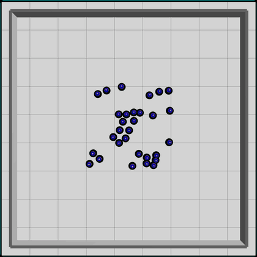
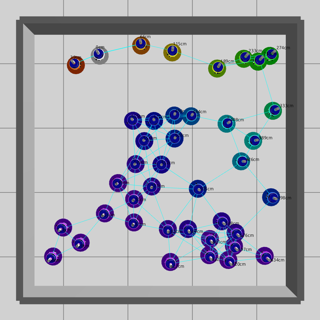
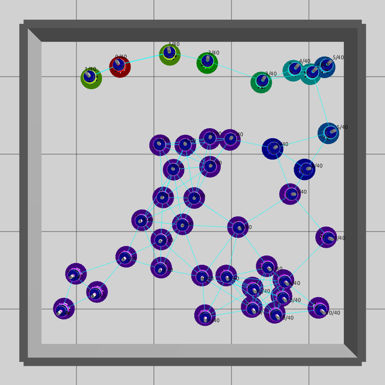
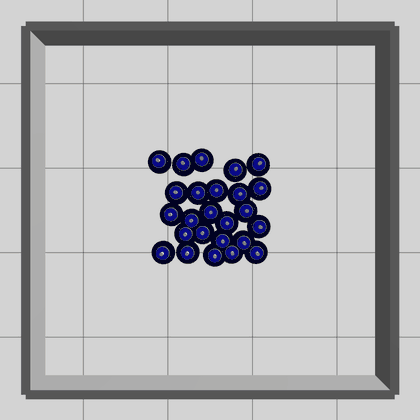
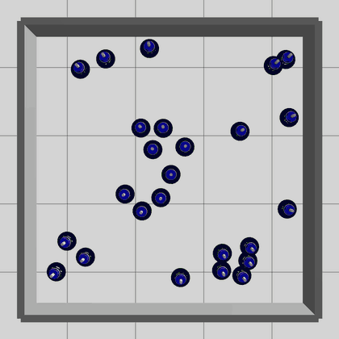

# Phyelds + ARGoS: aggregate programming for robot swarms

<p align="center"></p>

Five [Phyelds](https://github.com/phyelds/phyelds) programs run on foot-bots in
[ARGoS3](https://github.com/ilpincy/argos3), matching the arenas and behaviors of
the FCPP–ARGoS example. Every robot runs the same program, exchanging aggregate
state **only over its simulated range-and-bearing radio**. There is no GPS:
distances and relative vectors come from the radio; the positioning sensor is
used only as a compass.

| Example | What to observe | Program |
|---|---|---|
| `gradient` | White `fb0` is the source; labels show distance **along the network**, in centimetres | [gradient.py](src/phyelds_argos_examples/gradient.py) |
| `election` | The minimum UID becomes red; all 40 robots agree on labels `hops/40` | [election.py](src/phyelds_argos_examples/election.py) |
| `dispersion` | A packed group spreads to about 0.6 m spacing; green means settled | [dispersion.py](src/phyelds_argos_examples/dispersion.py) |
| `gathering` | Robots gather around the elected red leader, using vectors propagated along a gradient | [gathering.py](src/phyelds_argos_examples/gathering.py) |
| `flocking` | Separation, cohesion and heading alignment; equal LED colours mean aligned headings | [flocking.py](src/phyelds_argos_examples/flocking.py) |

| Gradient | Election |
|:---:|:---:|
|  |  |
| Dispersion | Gathering |
|  |  |

## Run the examples

You need an installed ARGoS3, CMake 3.18+, a C++17 compiler and Python **3.12 or
3.13** with development headers and a shared library. UV-managed Python includes
these. On recent Ubuntu, ARGoS can be built from source:

```bash
sudo apt install build-essential git cmake libfreeimage-dev libfreeimageplus-dev qt6-base-dev libglut-dev libxi-dev libxmu-dev
git clone https://github.com/ilpincy/argos3.git
cmake -S argos3/src -B argos3/build_simulator -DCMAKE_BUILD_TYPE=Release -DARGOS_DOCUMENTATION=OFF
cmake --build argos3/build_simulator --parallel 2
sudo cmake --install argos3/build_simulator
sudo ldconfig
```

From this project's root (`phyelds-argos` 8.9.0 or later, from PyPI):

```bash
uv venv --python 3.13
source .venv/bin/activate
uv pip install -e . pytest
python -m phyelds.argos.build --build-dir build

argos3 -c experiments/gradient.argos
argos3 -c experiments/election.argos
argos3 -c experiments/dispersion.argos
argos3 -c experiments/gathering.argos
argos3 -c experiments/flocking.argos
```

Run from this directory: the experiment files load `build/libphyelds_argos` and
`build/libphyelds_argos_qt` by relative path. In the GUI, press ▶ to start.
To develop against a Phyelds checkout next to this project, install
`-e ../phyelds -e ../phyelds/packages/phyelds-argos` too.

If `argos3` aborts with `GLib-GIO-ERROR … does not contain a key named
'antialiasing'`, the terminal belongs to a Snap application (e.g. VS Code) whose
GTK variables break the system Qt. Use a normal terminal, or clear them first:

```bash
unset GSETTINGS_SCHEMA_DIR GIO_MODULE_DIR GTK_PATH GTK_EXE_PREFIX GTK_IM_MODULE_FILE LOCPATH
export XDG_DATA_DIRS=/usr/local/share/:/usr/share/
```

The native plugin is built against the **Python executing the build command**,
including that environment's installed programs. Rebuild after moving the
environment or selecting another interpreter. When switching between the PyPI
package and a local checkout, delete `build/CMakeCache.txt` first: CMake rejects a
cache made from another source directory. For a machine without graphics:

```bash
python -m phyelds.argos.build --build-dir build --no-gui
python -m pytest -q                    # all programs and all real experiments
scripts/smoke.sh                       # real ARGoS experiments only
python -m pytest -q -m 'not argos'      # byte-transport program tests only
```

## How the integration works

Each foot-bot owns one `phyelds.vm.device.Device`. Every ARGoS tick, the host:

1. Receives the previous tick's radio messages and measures ranges/bearings.
2. Reads heading, proximity and simulation time; executes one aggregate round.
3. Broadcasts the new bytes and applies the program's `velocity`, `led` and `label` outputs.

The gradient is a whole swarm program:

```python
@aggregate
def main() -> float:
    source = sense("source")
    distance = float(distance_to(source, neighbors_distances()))
    store("led", (255, 255, 255) if source else hue(min(distance, 6) * 45))
    store("label", f"{int(distance * 100)}cm" if math.isfinite(distance) else "?")
    return distance
```

`neighbors_distances()` and `neighbors_vectors()` consume locally measured maps;
programs have no ARGoS imports. The gathering program reuses `cast_along` to
integrate neighbor offsets, and election composes `elect_leader`, `distance_to`,
`count_nodes` and `broadcast`. Election uses a deterministic candidacy strategy
and a 64-hop bound, larger than the diameter of these small networks.

The radio frame is `[u32 UID][u16 length][Device payload][padding]`. All robots
use compact alignment paths and a 4096-byte radio buffer. This is a **simulated
capacity**, larger than a physical foot-bot's default radio payload: the JSON
codec needs more room than FCPP's binary exports. An oversize export is reported
as an error; the host does not truncate or fragment it.

Velocities are in m/s in the common compass frame, capped by `max_speed` (default
0.1), then converted to differential wheel commands. LEDs are integer RGB
triples. The native plugin, build support and generic measured-geometry helpers
belong to Phyelds; these programs, arenas, weights and recording tools belong here.

## Add an example

1. Add an `@aggregate` function in `src/phyelds_argos_examples/<name>.py`.
2. Read sensors with `sense` and neighbors with Phyelds field operations. Write
   `velocity`, `led`, and `label` with `store`.
3. Copy an experiment and set `<params program="phyelds_argos_examples.<name>:main" />`.
4. Test it on `Device` and in its ARGoS arena.

Keep aggregate exchanges before local loops whose iteration counts differ among
robots; otherwise subsequent exchanges can acquire different alignment paths.
Moving local vector arithmetic into an ordinary Python helper also avoids this.

## Verification and recordings

The headless tests run all five experiments for 30 simulated seconds with seed 1.
They compare the gradient to shortest radio paths, require 40/40 counting
consensus, measure increased spacing and settling, check convergence towards a
stationary leader, and measure flock polarization and displacement. A separate
C++ **test observer** reads ground-truth poses for these assertions; they are
never available to the aggregate programs. Logs are kept in `build/*.log`.

CI builds a pinned ARGoS revision and installs both projects from source. It
expects the selected Phyelds revision to contain this integration; the manual
workflow accepts `phyelds_ref` for testing a development branch.

To regenerate the pictures, build with GUI support and use a working graphical
display (or `xvfb-run`), with FFmpeg installed:

```bash
scripts/record.sh gradient 10 png
scripts/record.sh election 20 png
scripts/record.sh dispersion 30 gif 3
scripts/record.sh gathering 30 gif 3
scripts/record.sh flocking 60 gif 5
```

Flocking and gathering use Phyelds's experimental swarm API, whose interface can
change between releases.
